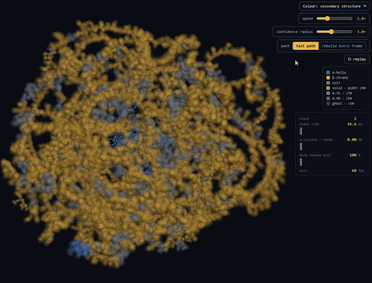
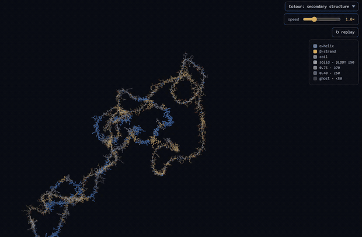

# Probble

**Protein + Wobble = Probble.** A browser renderer for AlphaFold structures that shows how much of a structure to believe.

**Live demo: https://jaysoma.dev/probble/** (the full AlphaFold structure library, browsable by fold class)



AlphaFold gives every residue a confidence score (pLDDT) and stores it in the B-factor column of every model. The usual way to show it is a color ramp, which hides the structure under a rainbow. Probble makes confidence part of the geometry: confident atoms are solid, uncertain ones turn translucent, and the regions AlphaFold is guessing at dissolve into haze.

## What it does

- **Confidence as opacity.** Each atom's opacity comes from its residue's pLDDT, drawn with depth-sorted translucency so the structure reads correctly from any angle. Built on per-atom sphere opacity, which I contributed to 3Dmol.js and which shipped in [3Dmol.js 3.0.0](https://github.com/3dmol/3Dmol.js/releases/tag/3.0.0) ([#858](https://github.com/3dmol/3Dmol.js/pull/858)).
- **Folding animation.** Watch a structure assemble, replayed at about 100 frames per second (5.3 ms per frame, no per-frame memory allocation) by updating coordinates in existing geometry instead of rebuilding it. Also contributed upstream and shipped in 3.0.0 ([#859](https://github.com/3dmol/3Dmol.js/pull/859), `setFrame(frame, {fast: true})`).

  

  *Illustration: an idealized extended chain moving into AlphaFold's predicted structure. Not a folding pathway.*
- **The probble render (Wobble view).** Where AlphaFold is confident, an atom is a sphere. Where it isn't, the atom is drawn as the space it could occupy: a probability ball that widens and thins as pLDDT falls, so disordered tails read as the clouds they are instead of frozen spaghetti. It's the crystallographer's thermal-ellipsoid convention (ORTEP), applied to AlphaFold confidence. The whole structure also sways along its own collective modes, the hinge and breathing motions an elastic network model finds on its confident core (`wobble.py`, ProDy), moved in place every frame on the same fast path. A slider scales the balls; at zero, every atom is a plain sphere again.

## Running it locally

```
python main.py        # serves this folder on http://127.0.0.1:8005
```

It's a static app: `main.py` is only a file server. Structures load from the local library when present, and from the AlphaFold Database API otherwise.

The Wobble view also needs each structure's collective modes, which stay out of git: `python wobble.py <UniProt accession>` writes `wobble/<accession>.bin` (needs NumPy and ProDy).

## Credits

Rendering is built on [3Dmol.js](https://github.com/3dmol/3Dmol.js) (Koes lab, University of Pittsburgh). Structures and confidence scores come from the [AlphaFold Protein Structure Database](https://alphafold.ebi.ac.uk/) (DeepMind and EMBL-EBI).
